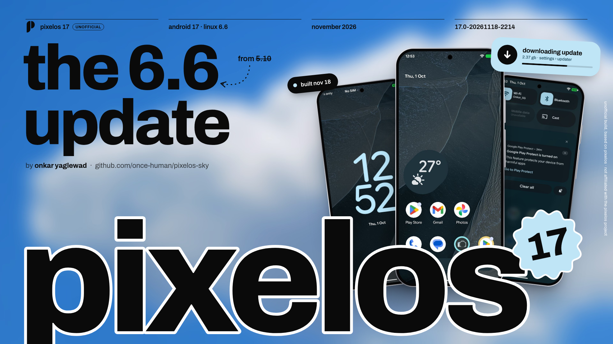

## pixelos 17 for sky | november 2026



redmi 12 5g, poco m6 pro 5g, redmi note 12r. unofficial. first build on linux 6.6.

build `17.0-20261118-2214`

### downloads

| file | for | |
|---|---|---|
| **[PixelOS_sky-17.0-20261118-2214-fastboot.zip](https://sourceforge.net/projects/pixelos-sky/files/17/2026-11/PixelOS_sky-17.0-20261118-2214-fastboot.zip/download)** | fastboot | recommended |
| [PixelOS_sky-17.0-20261118-2214.zip](https://sourceforge.net/projects/pixelos-sky/files/17/2026-11/PixelOS_sky-17.0-20261118-2214.zip/download) | recovery, sideload, updater | |
| [PixelOS_sky-17.0-20261118-2214-recovery.img](https://sourceforge.net/projects/pixelos-sky/files/17/2026-11/PixelOS_sky-17.0-20261118-2214-recovery.img/download) | pixelos recovery | optional |
| [SHA256SUMS](https://sourceforge.net/projects/pixelos-sky/files/17/2026-11/SHA256SUMS/download) | | checksums |

### notes

- **coming from october (5.10): clean install** (`fastboot -w update`). new kernel, new trees
- needs stock hyperos 2 firmware (OS2.0.210); the recovery zip flashes it for you
- user build, signed, selinux enforcing, security patch 2026-11-01
- kernel 6.6.144, qualcomm walt scheduler kept for battery
- google apps included
- ota updates from now on: settings > system > updater

### install (fastboot)

1. bootloader unlocked
2. platform-tools 35 or newer on your pc
3. phone in fastboot mode (power + volume down), plugged in
4. don't extract the zip, run:

```
fastboot -w update PixelOS_sky-17.0-20261118-2214-fastboot.zip
```

reboots by itself, first boot takes 5 to 10 minutes. on linux, if it says "disk quota exceeded": `mkdir -p ~/fb-tmp && TMPDIR=~/fb-tmp fastboot -w update ...`

### install (recovery)

recovery > format data (clean install only) > adb sideload > `adb sideload PixelOS_sky-17.0-20261118-2214.zip` > reboot.

### guides

[before you start](https://github.com/once-human/pixelos-sky/blob/main/docs/before-you-start.md) | [fastboot](https://github.com/once-human/pixelos-sky/blob/main/docs/install-fastboot.md) | [recovery](https://github.com/once-human/pixelos-sky/blob/main/docs/install-recovery.md) | [updating](https://github.com/once-human/pixelos-sky/blob/main/docs/updating.md) | [troubleshooting](https://github.com/once-human/pixelos-sky/blob/main/docs/troubleshooting.md) | [faq](https://github.com/once-human/pixelos-sky/blob/main/docs/faq.md)

### changelog

- linux 6.6 kernel (was 5.10), built from source
- new device trees from the sm4450 6.6 bring-up, hyperos 3 common blobs, sky os2.0.210 blobs and firmware
- smoother: zram lz4 + zstd recompression, mglru, tuned dalvik heap and lmk, settings/systemui compiled ahead of time, faster boot, tcp bbr, lazy rcu
- 90 hz, display cutout, rounded corners and status bar height set for sky
- 3-button nav, gestures and back gesture
- volte, vowifi and 5g carrier configs
- vibrator, audio and wifi fixes
- built-in ota updates

[CHANGELOG.md](https://github.com/once-human/pixelos-sky/blob/main/CHANGELOG.md)

### credits

venkat and the [xiaomi-ravelin](https://github.com/xiaomi-ravelin) team (6.6 trees, kernel, modules), suvojeet (6.6 kernel), [@topexguy](https://github.com/topexguy) (kernel fixes), moinator856 (panic logging), lostark13, [@anonytry](https://github.com/anonytry), [@jendermine](https://github.com/jendermine), pixelos and lineageos teams. [full credits](https://github.com/once-human/pixelos-sky/blob/main/CREDITS.md)
